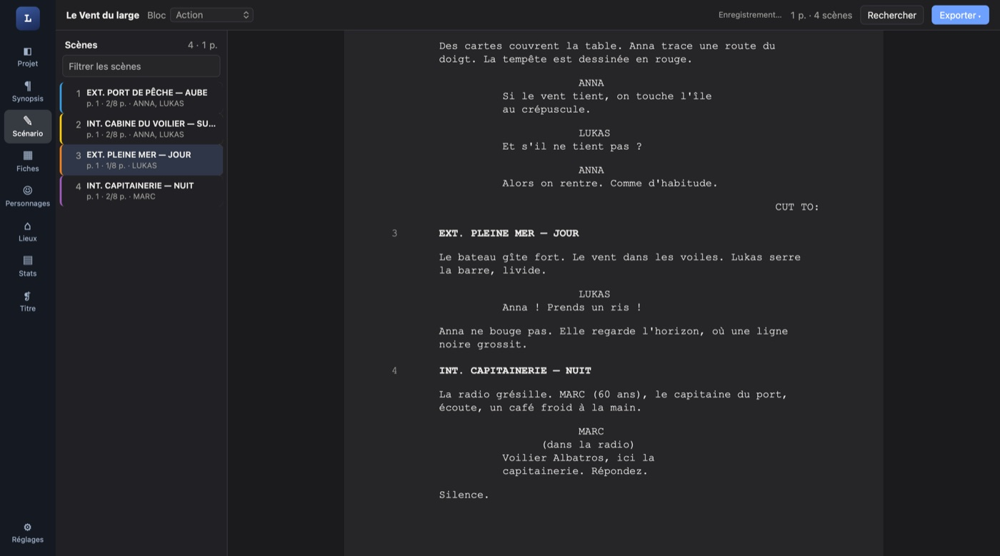
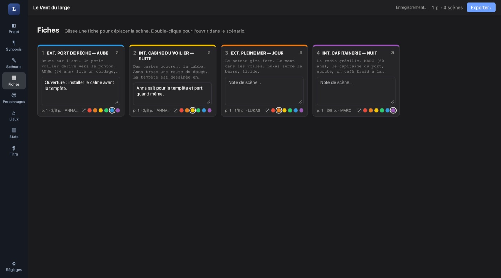
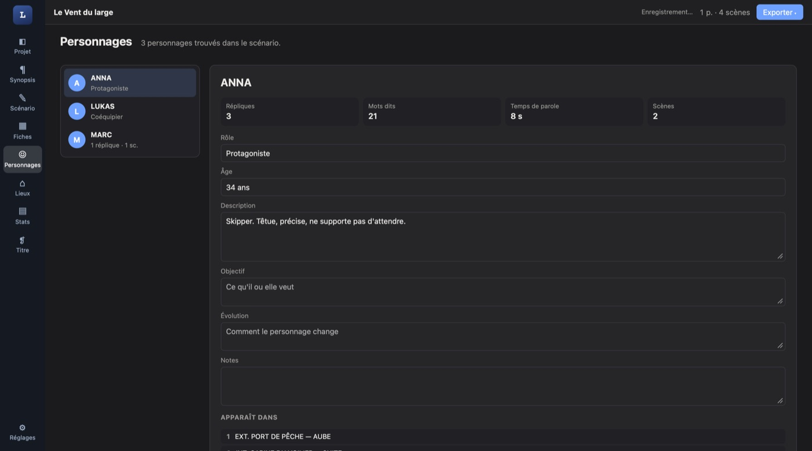
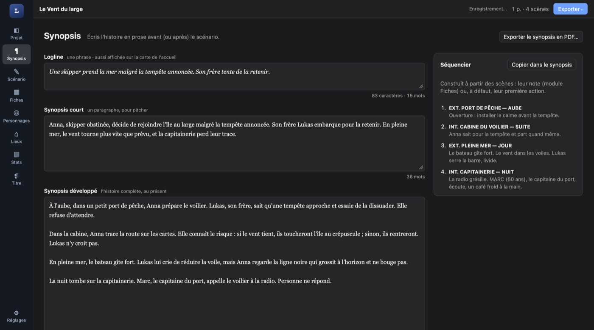
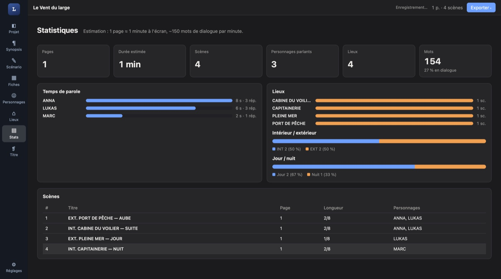
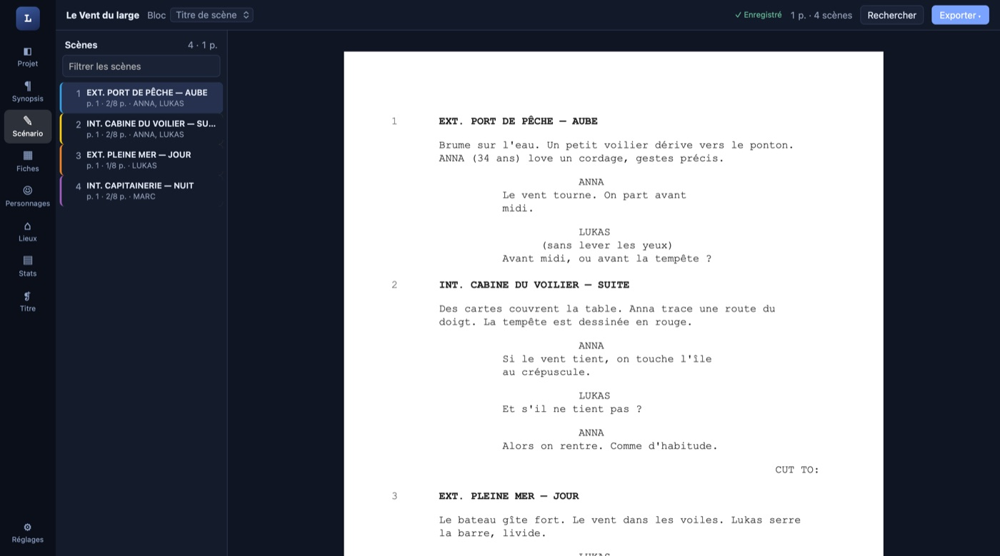

# Librescript

Éditeur de scénario pour macOS, en français. Écris ton film ou ta série au format scénario, organise tes scènes en fiches, suis tes personnages et tes lieux, et exporte en PDF, Final Draft ou Fountain.



## Installer

**En une ligne** (recommandé) : ouvre le Terminal (Applications → Utilitaires → Terminal), colle cette ligne et appuie sur Entrée :

```bash
curl -fsSL https://raw.githubusercontent.com/nvdrtx/librescript/main/install.sh | bash
```

Le script télécharge la dernière version, vérifie son empreinte SHA-256, installe Librescript dans **Applications** et l'ouvre. Relance la même ligne pour mettre à jour. Pour désinstaller (tes histoires sont conservées) :

```bash
curl -fsSL https://raw.githubusercontent.com/nvdrtx/librescript/main/install.sh | bash -s -- --uninstall
```

**Avec le .dmg** : télécharge [`Librescript.dmg`](https://github.com/nvdrtx/librescript/releases/latest/download/Librescript.dmg), ouvre-le et glisse Librescript dans le dossier Applications.

> Librescript n'est pas encore signée par Apple. Si tu l'installes avec le `.dmg`, macOS peut la bloquer au premier lancement :
> ouvre **Réglages Système → Confidentialité et sécurité**, puis clique sur **Ouvrir quand même** à côté de « Librescript a été bloquée ». Il ne faut le faire qu'une fois. L'installation en une ligne évite cette étape.

macOS 13 (Ventura) ou plus récent, Mac Apple Silicon ou Intel. Tes histoires sont rangées dans `Documents/Librescript`.

## Fonctionnalités

- **Éditeur au format scénario** : titres de scène, action, personnages, didascalies, dialogues, transitions. `Entrée` passe au bloc suivant logique, `Tab` change le type. Les sauts de page sont calculés comme sur papier (US Letter, Courier 12 pt, 1 page ≈ 1 minute).
- **Navigateur de scènes** : liste des scènes à côté du texte ; clic pour y aller, glisser pour réorganiser.
- **Rechercher / remplacer** : sensible à la casse ou non, limité à un type de bloc (ex. seulement les dialogues), `#12` pour aller à la scène 12. « Tout remplacer » s'annule en une fois.
- **Fiches** : une carte par scène, avec note et couleur ; glisser pour déplacer les scènes.
- **Personnages et lieux** : trouvés automatiquement dans le texte, avec une fiche à remplir et les scènes où ils apparaissent.
- **Synopsis** : logline, synopsis court, synopsis développé et séquencier généré à partir des scènes ; export PDF.
- **Statistiques** : pages, durée estimée, temps de parole par personnage, intérieur / extérieur, jour / nuit.
- **Page de titre** et **exports** : PDF (avec numéros de scène et de page), Final Draft `.fdx`, Fountain `.fountain`.
- **Import PDF** : retrouve scènes, personnages et dialogues d'un scénario PDF grâce à sa mise en page.
- **Projets rangés automatiquement** dans `Documents/Librescript`, **enregistrement automatique**, suppression vers la Corbeille.
- **Thèmes** : automatique, clair, sombre, sépia, nuit, forêt, contraste élevé, avec couleur d'accent au choix.

| Fiches | Personnages |
|---|---|
|  |  |

| Synopsis | Statistiques |
|---|---|
|  |  |



## Compiler depuis les sources

Il faut un Mac (macOS 13 ou plus récent) avec les outils de développement d'Apple (Xcode ou `xcode-select --install`).

```bash
git clone https://github.com/nvdrtx/librescript.git
cd librescript
./build-mac.sh --install
```

L'app est compilée dans `build/Librescript.app` puis copiée dans `~/Applications`. Sans `--install`, elle reste dans `build/`.

Pour fabriquer les installateurs (`dist/Librescript.dmg`, `dist/Librescript.zip`, `dist/SHA256SUMS`) et les publier comme release GitHub :

```bash
./make-release.sh            # construit dist/
./make-release.sh --publish  # et crée la release v<version> (avec l'outil gh connecté)
```

> L'app compilée est signée uniquement pour la machine qui la construit. Pour distribuer un `.app` téléchargeable, il faut la signer avec un certificat Apple « Developer ID » et la faire notariser.

## Tests

```bash
./run-tests.sh
```

Les tests de logique (pagination, personnages, lieux, déplacement de scènes, exports, import PDF, recherche) tournent avec le moteur JavaScript intégré à macOS, sans Node.

L'app contient aussi un autotest complet, qui pilote la vraie interface (recherche, chaque module, exports PDF et FDX, réimport du PDF, enregistrement automatique, suppression, thèmes) dans un dossier de test séparé :

```bash
mkdir -p /tmp/librescript-test/library
LIBRESCRIPT_LIBRARY=/tmp/librescript-test/library LIBRESCRIPT_SELFTEST=/tmp/librescript-test \
  build/Librescript.app/Contents/MacOS/Librescript
cat /tmp/librescript-test/results.json
```

## Organisation du code

```
index.html, styles.css        interface (HTML / CSS, sans dépendance)
src/main.js                   assemblage : écrans, modules, exports, API pour l'app Mac
src/editor/                   éditeur de scénario (modèle de blocs, annuler / rétablir)
src/search/                   recherche et remplacement (SearchManager + barre d'outils)
src/model/                    logique pure : analyse, pagination, exports, import PDF
src/views/                    accueil, navigateur, fiches, personnages, synopsis, stats, réglages…
macos/main.swift              app macOS : fenêtre, menus, fichiers, PDF, enregistrement automatique
build-mac.sh, run-tests.sh    compilation et tests
make-release.sh, install.sh   installateurs (.dmg, .zip) et installation en une ligne
```

L'interface web fonctionne aussi dans un navigateur (servie par un petit serveur local, par exemple `python3 -m http.server`) ; elle enregistre alors un brouillon dans le navigateur. L'import PDF, le dossier de projets et la suppression de fichiers ne sont disponibles que dans l'app Mac.

## Format des fichiers

Un fichier `.librescript` est du JSON lisible : `blocks` (le texte, bloc par bloc) et `meta` (projet, synopsis, page de titre, personnages, lieux).
